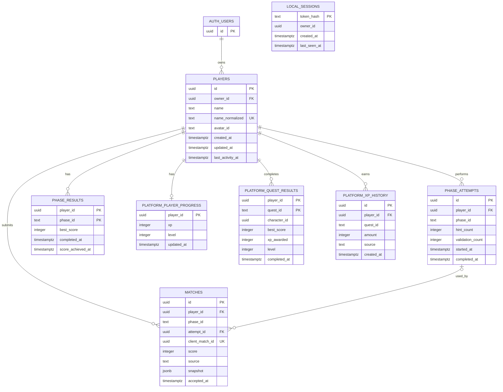
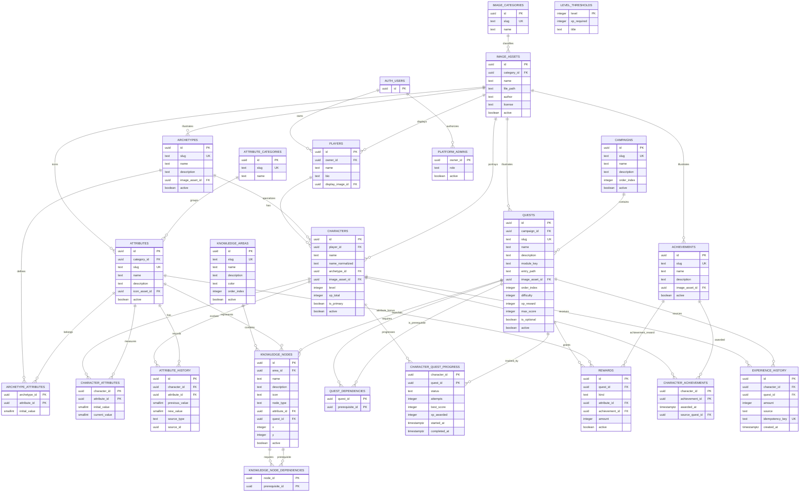
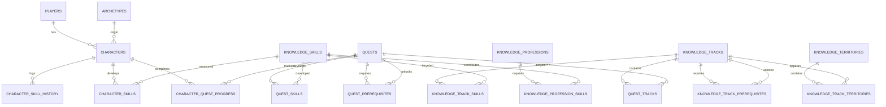

# Cafegeek — Jornada do Conhecimento

O NORMALIZA! é a **Quest 01** da Cafegeek, uma plataforma de aprendizagem baseada em desafios. O jogador constrói sua jornada, conclui quests e acompanha sua evolução.

Jogo educativo de normalização de bancos de dados. A cidade isométrica é o mapa: cada edifício representa uma tabela e as ruas representam relacionamentos. O jogador avança por quatro fases, uma missão especial de anomalias e um ranking assíncrono entre jogadores.

## Plataforma Cafegeek

- Área pública institucional em `#/`, com apresentação, territórios, como funciona, NORMALIZA e chamadas para cadastro/login.
- Rotas `#/login`, `#/registro` e `#/recuperar-senha`; área privada em `#/jogador` e subrotas `#/jogador/...`.
- Separação explícita entre identidade de autenticação (User) e identidade gamificada (Player).
- Autenticação local com e-mail/senha, hash `scrypt`, sessões no PostgreSQL e logout; Supabase Auth preparado para o cloud.
- Tela inicial própria, com logo original em `assets/images/branding/cafegeek-logo.webp`.
- Navegação para jornada, desafios, ranking e conquistas.
- Apresentação da Quest 01 — NORMALIZA!.
- Criação e edição de personagem com nome, retrato e arquétipo inicial.
- Arquétipos iniciais Engenheiro, Arquiteto e Analista.
- Catálogo administrável de arquétipos e atributos com valores iniciais de 1 a 10.
- Campanha Jornada do Conhecimento com quatro quests, dependências e estados individuais.
- Página de jornada com quests disponíveis, bloqueadas, em andamento e concluídas.
- Mapa-múndi com cinco territórios, trilhas, progresso e detalhe de quest em `#/mapa`; `#/arvore` permanece como alias.
- Catálogo de territórios, trilhas, habilidades e especializações no PostgreSQL local, com cálculo de afinidade.
- Rotas `#/territorio/:id`, `#/trilha/:id` e `#/quest/:id`, além do mapa na página inicial.
- NORMALIZA! posicionado na trilha Modelagem e Normalização do território Dados e Banco de Dados.
- Tela de habilidades em `#/habilidades`, com níveis, histórico e atividades por competência.
- Área Minha Especialização em `#/especializacoes` e no perfil, com afinidade calculada por habilidades.
- Administração local de perfis, arquétipos, atributos, valores iniciais e imagens de personagem.
- Administração local do mapa em `#/admin/mundo`: territórios, trilhas, habilidades, especializações, quests e relações.
- XP, níveis, progresso para o próximo nível e histórico de evolução.
- Atributos individuais que evoluem com recompensas de quests, limitados a 10.
- Conquistas de personagem e histórico recente de XP/atributos.
- Confirmação server-side da Quest 01 no modo local, após as quatro fases existirem em `phase_results`.
- Edge Function `complete-quest` e migration `002_platform.sql` preparadas para o mesmo fluxo no Supabase.
- Perfil de jogador com apelido, biografia e imagem.
- Área de próximas campanhas, ainda sem quests implementadas.
- O NORMALIZA! continua sendo um módulo independente, com rotas, regras e progresso preservados.

## Fases

- **Centro de Distribuição (1FN):** separar grupos repetitivos em linhas atômicas, preservando o pedido.
- **Rede de Dependências (2FN):** identificar dependências totais e parciais e decompor `ITEM_PEDIDO`.
- **Cidade Organizada (3FN):** identificar dependência transitiva, criar `FUNCIONÁRIO` e `DEPARTAMENTO`, definir PK/FK e relacionamento.
- **Gestão de Funcionários e Pedidos (3FN complementar):** decompor `PEDIDO` em `PEDIDO`, `FUNCIONÁRIO` e `DEPARTAMENTO`, com duas FKs e demonstração de anomalias.
- **Administração da Cidade (missão especial):** atualização, inserção e exclusão em modelos desnormalizados e normalizados.

Cada resposta incorreta traz explicação conceitual. O jogo oferece dicas, glossário, visualização antes/depois, medalhas e evolução da cidade.

## Perfis, ranking e offline

- A autenticação usa e-mail e senha; o perfil gamificado usa nome/apelido e avatar, sem CPF ou nome completo.
- O User é separado do Player; no escopo inicial cada conta possui um Player, e o progresso individual é associado a ele.
- O ranking é assíncrono e global; a pontuação oficial é validada no servidor.
- Jogadores podem consultar posição, pontos e diferença para o próximo colocado.
- Resultados offline ficam pendentes e são sincronizados quando o serviço volta.
- Progresso já concluído no navegador é reconciliado com o ranking ao abrir o jogo ou atualizar a classificação.
- Resultados pendentes não aparecem como confirmados.

## Tecnologias

- HTML5, CSS3, JavaScript ES6+ com ES Modules.
- SVG em camadas para a cidade e JSON para os desafios.
- Supabase Postgres, Auth por e-mail/senha, RLS, view de leaderboard e Edge Functions.
- PostgreSQL 16, Node 22 e nginx no modo Docker Compose local.
- `LocalStorage` para token de sessão, cache de progresso/ranking e fila pendente.
- Sem bundler, framework de frontend ou etapa de build.

## Arquitetura

- **`src/core/`**: regras puras de 1FN, 2FN, 3FN, Fase 4, anomalias, jogadores, personagens, arquétipos, atributos, quests, XP, níveis, conquistas, perfil, ranking e progresso.
- **`src/data/`**: validação estrutural dos JSONs.
- **`src/services/`**: fachada de backend, provedores Supabase/local, conteúdo PostgreSQL, resultados, progressão de quests, leaderboard e sincronização.
- **`src/persistence/`**: progresso e personagens por jogador, catálogo local, quests, progressão de personagem, fila, cache e migração do legado.
- **`src/services/content-service.js`**: leitura e gravação do catálogo no PostgreSQL via `/api/content`.
- **`src/services/auth-service.js`**: registro, login, logout, recuperação e vínculo User/Player nos providers local e Supabase.
- **`src/ui/publicHome.js`** e **`src/ui/auth.js`**: página pública, login, cadastro e onboarding do jogador.
- **`docker/api/src/content.js`**: seed e persistência das tabelas de conteúdo.
- **`src/core/world.js`**: progresso de territórios/trilhas, vínculos quest-habilidade e afinidade de especializações.
- **`src/persistence/worldStorage.js`**: cache/fallback local versionado do mapa-múndi.
- **`src/ui/worldMap.js`**: mapa interativo, territórios, trilhas e detalhe de quest.
- **`src/ui/skills.js`** e **`src/ui/specializations.js`**: habilidades e afinidade profissional.
- **`src/ui/worldAdmin.js`**: administração local de territórios, trilhas, habilidades, especializações e quests.
- **`src/state/` e `src/router/`**: estado e rotas por hash, incluindo páginas públicas, autenticação, área do jogador, mapa, território, trilha, quest, habilidades e administração.
- **`src/ui/`**: início Cafegeek, jornada de quests, personagem, administração, cidade, arte isométrica detalhada em `cityArt.js`, HUD, fases, missão, identidade, perfil, ranking, conquistas, Sobre e ajuda.
- **`data/`**: cidade, fases, missão, glossário, dicas e `content.seed.json` usado para popular o PostgreSQL.
- **`supabase/`**: migrations, RLS e Edge Functions.
- **`docker/` e `db/`**: API local, nginx e migrations do modo Docker Compose.
- **`config/`**: URL/publishable key públicas e seleção de backend em `config/runtime.js`.
- **`tests/`**: harness no navegador; `tools/verify.ps1` executa headless.

## Modelo MER do banco de dados

### Modelo atual implementado

O diagrama abaixo representa o schema original de ranking e progressão. O PostgreSQL local também possui as tabelas de conhecimento, personagens, habilidades, quests e especializações criadas por `db/migrations/004_world.sql`; o Supabase correspondente está em `supabase/migrations/003_world.sql`, ainda pendente de aplicação. O catálogo do mapa é semeado pela API e servido por `GET /api/content`; a administração usa `PUT /api/content` no modo Docker.



### Modelo alvo planejado

> Este diagrama é histórico. O modelo aprovado para territórios, trilhas, habilidades e especializações está detalhado em **Modelo do mapa de conhecimento** e prevalece sobre a parte de `KNOWLEDGE_AREAS`/`KNOWLEDGE_NODES` deste diagrama.

No modo local existe uma tabela `users` com e-mail, hash de senha e status; `players.user_id` referencia essa identidade. No Supabase, `players.owner_id` referencia `auth.users` e a senha é gerenciada pelo Auth.

O modelo abaixo organiza a evolução completa da plataforma: personagens, arquétipos, atributos, catálogo visual, campanhas, quests, dependências, recompensas, XP e conquistas. As entidades do mundo e quests já usam o PostgreSQL local; personagens, atributos, imagens e progressão individual ainda usam `LocalStorage` nesta versão.



O NORMALIZA! mantém as tabelas atuais `players`, `phase_attempts`, `matches` e `phase_results` como fonte oficial das fases e do ranking. A migração alvo deve preservar esses dados e ligar a conclusão da Quest 01 aos registros de `character_quest_progress` e `experience_history`.

### Modelo do mapa de conhecimento

O modelo aprovado para territórios, trilhas, habilidades e especializações foi criado no PostgreSQL local em `db/migrations/004_world.sql`. O catálogo é semeado pela API e servido ao frontend; `LocalStorage` permanece como cache/fallback offline e para dados individuais de progressão.



- `knowledge_territories`: os cinco territórios e suas posições no mapa.
- `knowledge_tracks`: trilhas; podem aparecer em vários territórios.
- `knowledge_skills`: habilidades sem colunas fixas por personagem.
- `knowledge_professions`: especializações possíveis, sem classe de personagem.
- `quests`, `quest_tracks`, `quest_skills`, `quest_prerequisites`: catálogo e relações muitos-para-muitos.
- `characters`, `character_skills`, `character_skill_history`, `character_quest_progress`: progresso individual.
- `character_track_progress`, `character_territory_progress` e `character_profession_affinity`: views derivadas, sem duplicar estado.

A afinidade de especialização é calculada por peso e nível-alvo das habilidades. Nenhuma especialização concede ou remove acesso a conteúdo.

## Cidade visual

A cena é um SVG em camadas com ilha, parque central, ruas, calçadas, edifícios detalhados, vegetação, postes, bancos, fonte, lago, veículos e personagens. `cityScene.js` mantém seleção, extensões, links, rótulos, badges e contratos de interação; `cityArt.js` concentra a arte e os elementos urbanos. A composição é responsiva, ordenada por profundidade e respeita `prefers-reduced-motion`. Nenhuma regra de normalização ou validação depende da camada visual.

## Organização dos diretórios

```text
.
├── index.html
├── compose.yaml
├── .env.example
├── assets/
│   ├── css/app.css
│   ├── css/platform.css
│   └── images/branding/cafegeek-logo.webp
├── config/
│   ├── supabase.js
│   ├── supabase.example.js
│   └── runtime.js
├── db/migrations/
├── docker/api/
├── docker/web/
├── data/
│   ├── city.json
│   ├── glossary.json
│   ├── tips.json
│   ├── phases/fase-1.json ... fase-4.json
│   └── missions/administracao.json
├── src/
│   ├── main.js
│   ├── core/
│   ├── data/
│   ├── persistence/
│   ├── router/
│   ├── services/
│   ├── state/
│   └── ui/
├── supabase/
│   ├── migrations/001_schema.sql, 002_platform.sql, 003_world.sql, 004_auth.sql
│   └── functions/
├── tests/
├── tools/
├── docs/
└── README.md
```

## Executar localmente

Não há build. Sirva o projeto por HTTP:

```powershell
py -m http.server 8000 --directory .
```

Abra:

- Aplicação: `http://localhost:8000/`
- Testes unitários: `http://localhost:8000/tests/run-tests.html`
- Interações da Fase 1: `http://localhost:8000/tests/interactions.html`
- Interações da Fase 2: `http://localhost:8000/tests/interactions-phase2.html`
- Interações da Fase 3: `http://localhost:8000/tests/interactions-phase3.html`
- Interações da Fase 4: `http://localhost:8000/tests/interactions-phase4.html`
- Jogadores, perfil e ranking: `http://localhost:8000/tests/interactions-players.html`
- Administração de arquétipos/atributos: `http://localhost:8000/tests/interactions-admin.html`
- Missão especial: `http://localhost:8000/tests/interactions-mission.html`
- Progresso e recuperação: `http://localhost:8000/tests/interactions-progress.html`

Verificação completa:

```powershell
powershell -ExecutionPolicy Bypass -File tools/verify.ps1
```

Use `-SkipScreenshots` para executar somente os testes.

Verificação do backend local, com autenticação, conclusão da quest, idempotência e isolamento entre jogadores:

```powershell
powershell -ExecutionPolicy Bypass -File tools/verify-local-backend.ps1
```

## Modo local com Docker Compose

O Compose sobe o app completo, a API local e o PostgreSQL:

```powershell
Copy-Item .env.example .env
docker compose up -d --build
```

Edite `.env` e troque `POSTGRES_PASSWORD`. O arquivo `.env` é ignorado pelo git.

- App: `http://localhost:8080/`
- Health da API: `http://localhost:8080/api/health`
- PostgreSQL: porta apenas interna; não é publicado no host.
- API: porta apenas interna; o acesso passa pelo nginx.

O modo local é **independente do Supabase**, usa uma API Node mínima e começa com o ranking vazio. O nginx gera `config/runtime.js` em runtime para selecionar o provedor local.

Na primeira inicialização, a API popula o catálogo de territórios, trilhas, habilidades, especializações e quests a partir de `data/content.seed.json`. O frontend lê `GET /api/content`; o administrador local salva em `PUT /api/content`. Se a API estiver indisponível, o app usa o cache em `LocalStorage` e os seeds locais como fallback.

Comandos:

```text
docker compose ps
docker compose logs -f api
docker compose down       # preserva o volume
docker compose down -v    # apaga o banco local; destrutivo
```

A API local também expõe `POST /api/auth/register`, `POST /api/auth/login`, `POST /api/auth/logout`, `GET /api/auth/me`, `GET/POST/PATCH /api/players/me` e confirma a Quest 01 em `POST /api/quests/normaliza/complete`, mas somente quando as quatro fases já existem em `phase_results`; XP e nível são calculados no servidor e gravados uma única vez.

O volume local é `normaliza-pgdata`. A autenticação local usa a tabela `users` com hash `scrypt` e sessões vinculadas; o perfil do jogador usa `players.user_id`. O progresso detalhado ainda continua em `LocalStorage`; o banco guarda usuários, perfis, resultados compartilhados e o catálogo do mapa. A recuperação de senha local não envia e-mail; o Supabase Auth oferece esse fluxo no cloud.

Mais detalhes: [`docs/local-development.md`](docs/local-development.md).

## Supabase

A configuração pública fica em `config/supabase.js`. O app usa somente a URL e a publishable key; a service role nunca é enviada ao navegador.

O passo a passo completo, incluindo SQL Editor, RLS, Edge Functions e CORS, está em [`docs/supabase-setup.md`](docs/supabase-setup.md).

Resumo:

1. Aplicar `supabase/migrations/001_schema.sql`, `002_platform.sql`, `003_world.sql` e `004_auth.sql` no SQL Editor.
2. Publicar as Edge Functions de `supabase/functions/`, incluindo `complete-quest`.
3. Manter `SUPABASE_SERVICE_ROLE_KEY` apenas nos secrets do Supabase.
4. Abrir o app e criar um perfil; o ranking ficará indisponível até o backend estar publicado.

O provider Supabase também pode ser usado com um stack local iniciado por `supabase start`, apontando a configuração pública para essa instância.

O jogo continua funcional sem o backend. Nesse modo, perfis e progresso são locais, resultados ficam pendentes e o ranking mostra o último cache ou estado offline.

## Ranking e segurança

- A pontuação oficial é recalculada no servidor a partir da solução enviada.
- O navegador não envia um total confiável.
- `client_match_id` impede duplicação; o melhor resultado por fase é mantido.
- O ranking ordena por pontos, fases concluídas e momento em que a pontuação foi alcançada.
- RLS impede escrita direta em jogadores, tentativas, partidas e resultados.
- O ranking público expõe apenas nome, avatar, pontos, fases e posição.
- Perfis e resultados privados são acessíveis somente ao jogador dono.

## Criar novas fases

O escopo atual vai até a 3FN. Não implemente BCNF, 4FN ou 5FN sem solicitação.

1. Crie o JSON em `data/phases/` seguindo `fase-4.json`.
2. Implemente as regras puras em `src/core/`.
3. Implemente a validação estrutural em `src/data/` e registre no boot de `src/main.js`.
4. Crie o controller em `src/ui/`, com alternativa a drag-and-drop e foco gerenciado.
5. Registre o host em `index.html`, o controller e a definição em `src/main.js`.
6. Atualize a cidade e a coordenação de evolução.
7. Atualize o servidor: `supabase/functions/_shared/phase-data.js` e a cópia canônica das regras.
8. Cubra regras, dados, interação, progresso, cidade e servidor com testes.
9. Rode `tools/verify.ps1`.

Regras conceituais obrigatórias:

- 1FN: valores atômicos, sem grupos repetitivos.
- 2FN: já em 1FN; eliminar dependências parciais de atributos não primos.
- 3FN: já em 2FN; para toda DF não trivial `X → A`, `X` é superchave ou `A` é atributo primo.
- Decomposição: preservar informação, verificar junção sem perda, preservar DFs e identificar PKs/FKs.
- Nunca inferir DF apenas pela amostra. Declare as regras do domínio.

## Alterar desafios

- Fases: `data/phases/fase-1.json` até `fase-4.json`.
- Missão: `data/missions/administracao.json`.
- Cidade: `data/city.json`.
- Glossário e dicas: `data/glossary.json` e `data/tips.json`.

Mantenha coerência entre atributos, linhas, DFs, tabelas de destino, PKs, FKs, relacionamentos, conceitos, dicas, evolução da cidade, pontuação e testes.

Depois de alterar:

1. Atualize a especificação canônica em `supabase/functions/_shared/phase-data.js` e as cópias das regras.
2. Atualize snapshots de teste, se necessário.
3. Rode os testes de regras, dados e interação.
4. Rode `tools/verify.ps1`.
5. Teste o modo offline e o backend real quando disponível.

Não enfraqueça validadores para fazer um teste passar. Soluções que perdem informação, perdem junção, usam PK/FK incorreta ou inferem DFs não declaradas devem ser rejeitadas com explicação.

## Publicar no GitHub Pages

O runtime é composto por:

- `index.html`
- `assets/`
- `src/`
- `data/`
- `config/`

Não publique `tests/`, `tools/`, `supabase/`, `docs/`, `AGENTS.md` ou `README.md`.

### Em `CafeGeek/docs/normaliza/`

```powershell
robocopy . ..\CafeGeek\docs\normaliza /E /XD .git tests tools supabase docs docker db /XF AGENTS.md README.md compose.yaml .env.example .dockerignore .gitignore
```

Depois faça commit/push no repositório do CafeGeek. O app deve funcionar em:

`https://cafegeek.eti.br/normaliza/`

A aplicação usa caminhos relativos e foi validada em subdiretório. Não altere layouts ou configurações globais do CafeGeek. As Edge Functions permanecem no Supabase; o GitHub Pages hospeda apenas o frontend.

## Relatório final da evolução Cafegeek

1. **Diagnóstico:** a base era uma SPA estática do NORMALIZA!, com regras puras, persistência por navegador, backend local/Supabase e ranking de fases. A arquitetura foi evoluída sem reimplementar o jogo.
2. **Modelo conceitual:** jogador, personagem, arquétipo, atributo, campanha, quest, progresso, XP, nível e conquista foram separados.
3. **Modelo relacional:** o schema atual e o modelo alvo normalizado estão representados nos dois diagramas MER deste README.
4. **Interfaces:** início Cafegeek, mapa-múndi de cinco territórios, trilhas, detalhe de quest, habilidades, especializações, jornada, desafios, personagem, administração do mapa, perfil, ranking, conquistas, cidade, fases e missão.
5. **Arquivos principais:** `src/core/quests.js`, `src/core/progression.js`, `src/core/world.js`, `src/core/characters.js`, `src/persistence/questStorage.js`, `src/persistence/progressionStorage.js`, `src/persistence/worldStorage.js`, `src/persistence/imageStorage.js`, `src/ui/worldMap.js`, `src/ui/skills.js`, `src/ui/specializations.js`, `src/ui/worldAdmin.js`, `src/ui/character.js`, `src/ui/challenges.js`, `src/ui/admin.js`, `db/migrations/004_world.sql`, `supabase/functions/complete-quest/`.
6. **Funcionalidades:** logo original Cafegeek, Quest 01, quatro quests com dependências, personagem editável, catálogo administrável de arquétipos/atributos, imagens de personagem, mapa-múndi com cinco territórios e trilhas, NORMALIZA na trilha Modelagem e Normalização, habilidades com histórico e atividades, especializações com afinidade, administração local de territórios/trilhas/habilidades/especializações/quests, valores 1–10, XP/níveis, evolução de atributos, conquistas e confirmação local server-side da Quest 01.
7. **Migrations:** `001_core.sql`, `002_local.sql`, `003_platform.sql`, `004_world.sql`, `005_content_order.sql` e `006_auth.sql` foram aplicadas no PostgreSQL local. `001_schema.sql`, `002_platform.sql`, `003_world.sql` e `004_auth.sql` estão preparadas no diretório `supabase/migrations/`, mas ainda não foram aplicadas no projeto cloud.
8. **Testes:** 188 testes unitários, suítes de interação das fases, jogadores/ranking, administração, missão e progresso, mapa/trilhas/habilidades/especializações e 32 screenshots; verificação do backend local com autenticação, catálogo PostgreSQL, quest incompleta, idempotência e isolamento entre jogadores.
9. **Limitações:** User/Player e o perfil do jogador já usam autenticação local/PostgreSQL, mas a progressão detalhada e as imagens ainda usam `LocalStorage`; recuperação de senha local não envia e-mail; a autorização administrativa de produção e a persistência server-side de habilidades/progresso continuam pendentes.
10. **Próximas melhorias:** migrar personagens/habilidades e progressão individual para o banco, aplicar RLS administrativa no Supabase, publicar as Edge Functions, implementar validação genérica de quests e sincronizar recompensas de habilidades no servidor.

## Limitações conhecidas

- O schema e as Edge Functions do Supabase cloud ainda precisam ser aplicados/deployados.
- O catálogo do mapa é servido pelo PostgreSQL via API; `LocalStorage` mantém cache/fallback. As tabelas `characters`, `character_skills` e progresso individual ainda não são usadas pela API.
- User/Player, login, cadastro, logout e rotas privadas estão implementados; a progressão individual ainda é local.
- Jogadores antigos sem `user_id` permanecem como registros legados; a associação a uma nova conta exige um fluxo de reivindicação.
- Habilidades e especializações possuem telas e cálculo de afinidade; o catálogo do mundo é compartilhado pelo PostgreSQL, mas a progressão individual ainda é local.
- O Compose local é um backend independente; rankings cloud e local não são mesclados.
- No modo local, o token de sessão fica no navegador, mas usuários e sessões são validados no PostgreSQL; o progresso detalhado ainda é local.
- Resultados offline usam política conservadora; tentativas/dicas offline não são verificáveis.
- A missão especial permanece em memória.
- O banco local depende do volume `normaliza-pgdata`; `docker compose down -v` apaga os dados.
- O ranking compartilhado exige backend disponível; o jogo local continua offline.
- Não há BCNF, 4FN ou 5FN no escopo.
- Ruby/Jekyll e Deno não estão disponíveis neste ambiente. O Supabase CLI `3.1.0` e o Docker Desktop `4.99.0` estão instalados; o engine Docker está em execução. Abra um novo terminal para carregar os PATHs de `supabase` e `docker`.
