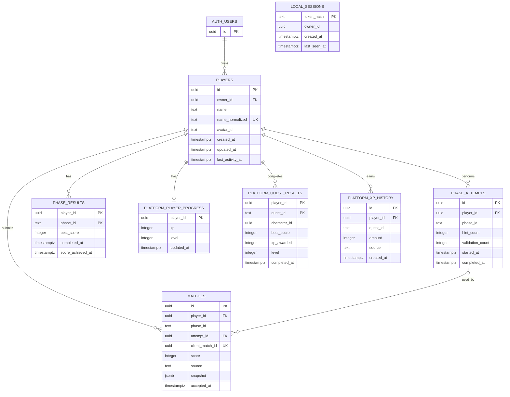

# Cafegeek — Jornada do Conhecimento

O NORMALIZA! é a **Quest 01** da Cafegeek, uma plataforma de aprendizagem baseada em desafios. O jogador constrói sua jornada, conclui quests e acompanha sua evolução.

Jogo educativo de normalização de bancos de dados. A cidade isométrica é o mapa: cada edifício representa uma tabela e as ruas representam relacionamentos. O jogador avança por quatro fases, uma missão especial de anomalias e um ranking assíncrono entre jogadores.

## Plataforma Cafegeek

- Tela inicial própria, com logo original em `assets/images/branding/cafegeek-logo.webp`.
- Navegação para jornada, desafios, ranking e conquistas.
- Apresentação da Quest 01 — NORMALIZA!.
- Criação e edição de personagem com nome, retrato e arquétipo inicial.
- Arquétipos iniciais Engenheiro, Arquiteto e Analista.
- Catálogo administrável de arquétipos e atributos com valores iniciais de 1 a 10.
- Campanha Jornada do Conhecimento com quatro quests, dependências e estados individuais.
- Página de jornada com quests disponíveis, bloqueadas, em andamento e concluídas.
- Árvore de conhecimento visual por áreas, com nós ligados a habilidades e quests.
- Administração local de perfis, arquétipos, atributos, valores iniciais e imagens de personagem.
- XP, níveis, progresso para o próximo nível e histórico de evolução.
- Atributos individuais que evoluem com recompensas de quests, limitados a 10.
- Conquistas de personagem e histórico recente de XP/atributos.
- Confirmação server-side da Quest 01 no modo local, após as quatro fases existirem em `phase_results`.
- Edge Function `complete-quest` e migration `002_platform.sql` preparadas para o mesmo fluxo no Supabase.
- Perfil de jogador com apelido, biografia e imagem.
- Área de próximas campanhas, ainda sem quests implementadas.
- O NORMALIZA! continua sendo um módulo independente, com rotas, regras e progresso preservados.

## Fases

- **Centro de Distribuição (1FN):** separar grupos repetitivos em linhas atômicas, preservando o pedido.
- **Rede de Dependências (2FN):** identificar dependências totais e parciais e decompor `ITEM_PEDIDO`.
- **Cidade Organizada (3FN):** identificar dependência transitiva, criar `FUNCIONÁRIO` e `DEPARTAMENTO`, definir PK/FK e relacionamento.
- **Gestão de Funcionários e Pedidos (3FN complementar):** decompor `PEDIDO` em `PEDIDO`, `FUNCIONÁRIO` e `DEPARTAMENTO`, com duas FKs e demonstração de anomalias.
- **Administração da Cidade (missão especial):** atualização, inserção e exclusão em modelos desnormalizados e normalizados.

Cada resposta incorreta traz explicação conceitual. O jogo oferece dicas, glossário, visualização antes/depois, medalhas e evolução da cidade.

## Perfis, ranking e offline

- A identificação usa nome/apelido e avatar, sem e-mail, CPF ou nome completo.
- Cada navegador pode ter vários perfis locais. O progresso de um jogador é independente.
- O ranking é assíncrono e global; a pontuação oficial é validada no servidor.
- Jogadores podem consultar posição, pontos e diferença para o próximo colocado.
- Resultados offline ficam pendentes e são sincronizados quando o serviço volta.
- Progresso já concluído no navegador é reconciliado com o ranking ao abrir o jogo ou atualizar a classificação.
- Resultados pendentes não aparecem como confirmados.

## Tecnologias

- HTML5, CSS3, JavaScript ES6+ com ES Modules.
- SVG em camadas para a cidade e JSON para os desafios.
- Supabase Postgres, Auth anônimo, RLS, view de leaderboard e Edge Functions.
- PostgreSQL 16, Node 22 e nginx no modo Docker Compose local.
- `LocalStorage` para perfis, progresso, cache de ranking e fila pendente.
- Sem bundler, framework de frontend ou etapa de build.

## Arquitetura

- **`src/core/`**: regras puras de 1FN, 2FN, 3FN, Fase 4, anomalias, jogadores, personagens, arquétipos, atributos, quests, XP, níveis, conquistas, perfil, ranking e progresso.
- **`src/data/`**: validação estrutural dos JSONs.
- **`src/services/`**: fachada de backend, provedores Supabase/local, resultados, progressão de quests, leaderboard e sincronização.
- **`src/persistence/`**: progresso e personagens por jogador, catálogo local, quests, progressão de personagem, fila, cache e migração do legado.
- **`src/state/` e `src/router/`**: estado e rotas por hash.
- **`src/ui/`**: início Cafegeek, jornada de quests, personagem, administração, cidade, arte isométrica detalhada em `cityArt.js`, HUD, fases, missão, identidade, perfil, ranking, conquistas, Sobre e ajuda.
- **`data/`**: cidade, fases, missão, glossário e dicas.
- **`supabase/`**: migrations, RLS e Edge Functions.
- **`docker/` e `db/`**: API local, nginx e migrations do modo Docker Compose.
- **`config/`**: URL/publishable key públicas e seleção de backend em `config/runtime.js`.
- **`tests/`**: harness no navegador; `tools/verify.ps1` executa headless.

## Modelo MER do banco de dados

### Modelo atual implementado

O diagrama abaixo representa o schema realmente disponível no PostgreSQL local e nas migrations do Supabase. A view `leaderboard` não é uma tabela; ela agrega `players` e `phase_results`. O campo `platform_quest_results.character_id` ainda não possui FK para uma tabela de personagens, pois a ficha completa do personagem permanece local nesta versão.



### Modelo alvo planejado

No modo local não existe a tabela `auth.users`; o dono é representado por um UUID de sessão. No Supabase, `players.owner_id` referencia `auth.users`.

O modelo abaixo organiza a evolução completa da plataforma: personagens, arquétipos, atributos, catálogo visual, campanhas, quests, dependências, recompensas, XP e conquistas. Ele ainda não foi migrado para o PostgreSQL; nesta versão, essas entidades estão em `LocalStorage`.


O NORMALIZA! mantém as tabelas atuais `players`, `phase_attempts`, `matches` e `phase_results` como fonte oficial das fases e do ranking. A migração alvo deve preservar esses dados e ligar a conclusão da Quest 01 aos registros de `character_quest_progress` e `experience_history`.

## Cidade visual

A cena é um SVG em camadas com ilha, parque central, ruas, calçadas, edifícios detalhados, vegetação, postes, bancos, fonte, lago, veículos e personagens. `cityScene.js` mantém seleção, extensões, links, rótulos, badges e contratos de interação; `cityArt.js` concentra a arte e os elementos urbanos. A composição é responsiva, ordenada por profundidade e respeita `prefers-reduced-motion`. Nenhuma regra de normalização ou validação depende da camada visual.

## Organização dos diretórios

```text
.
├── index.html
├── compose.yaml
├── .env.example
├── assets/
│   ├── css/app.css
│   ├── css/platform.css
│   └── images/branding/cafegeek-logo.webp
├── config/
│   ├── supabase.js
│   ├── supabase.example.js
│   └── runtime.js
├── db/migrations/
├── docker/api/
├── docker/web/
├── data/
│   ├── city.json
│   ├── glossary.json
│   ├── tips.json
│   ├── phases/fase-1.json ... fase-4.json
│   └── missions/administracao.json
├── src/
│   ├── main.js
│   ├── core/
│   ├── data/
│   ├── persistence/
│   ├── router/
│   ├── services/
│   ├── state/
│   └── ui/
├── supabase/
│   ├── migrations/001_schema.sql, 002_platform.sql
│   └── functions/
├── tests/
├── tools/
├── docs/
└── README.md
```

## Executar localmente

Não há build. Sirva o projeto por HTTP:

```powershell
py -m http.server 8000 --directory .
```

Abra:

- Aplicação: `http://localhost:8000/`
- Testes unitários: `http://localhost:8000/tests/run-tests.html`
- Interações da Fase 1: `http://localhost:8000/tests/interactions.html`
- Interações da Fase 2: `http://localhost:8000/tests/interactions-phase2.html`
- Interações da Fase 3: `http://localhost:8000/tests/interactions-phase3.html`
- Interações da Fase 4: `http://localhost:8000/tests/interactions-phase4.html`
- Jogadores, perfil e ranking: `http://localhost:8000/tests/interactions-players.html`
- Administração de arquétipos/atributos: `http://localhost:8000/tests/interactions-admin.html`
- Missão especial: `http://localhost:8000/tests/interactions-mission.html`
- Progresso e recuperação: `http://localhost:8000/tests/interactions-progress.html`

Verificação completa:

```powershell
powershell -ExecutionPolicy Bypass -File tools/verify.ps1
```

Use `-SkipScreenshots` para executar somente os testes.

Verificação do backend local, com autenticação, conclusão da quest, idempotência e isolamento entre jogadores:

```powershell
powershell -ExecutionPolicy Bypass -File tools/verify-local-backend.ps1
```

## Modo local com Docker Compose

O Compose sobe o app completo, a API local e o PostgreSQL:

```powershell
Copy-Item .env.example .env
docker compose up -d --build
```

Edite `.env` e troque `POSTGRES_PASSWORD`. O arquivo `.env` é ignorado pelo git.

- App: `http://localhost:8080/`
- Health da API: `http://localhost:8080/api/health`
- PostgreSQL: porta apenas interna; não é publicado no host.
- API: porta apenas interna; o acesso passa pelo nginx.

O modo local é **independente do Supabase**, usa uma API Node mínima e começa com o ranking vazio. O nginx gera `config/runtime.js` em runtime para selecionar o provedor local.

Comandos:

```text
docker compose ps
docker compose logs -f api
docker compose down       # preserva o volume
docker compose down -v    # apaga o banco local; destrutivo
```

A API local também confirma a Quest 01 em `POST /api/quests/normaliza/complete`, mas somente quando as quatro fases já existem em `phase_results`; XP e nível são calculados no servidor e gravados uma única vez.

O volume local é `normaliza-pgdata`. O progresso no navegador continua em `LocalStorage`; o banco guarda os perfis e resultados compartilhados do modo local. O ranking local e o ranking Supabase não são mesclados.

Mais detalhes: [`docs/local-development.md`](docs/local-development.md).

## Supabase

A configuração pública fica em `config/supabase.js`. O app usa somente a URL e a publishable key; a service role nunca é enviada ao navegador.

O passo a passo completo, incluindo SQL Editor, RLS, Edge Functions e CORS, está em [`docs/supabase-setup.md`](docs/supabase-setup.md).

Resumo:

1. Aplicar `supabase/migrations/001_schema.sql` e `002_platform.sql` no SQL Editor.
2. Publicar as Edge Functions de `supabase/functions/`, incluindo `complete-quest`.
3. Manter `SUPABASE_SERVICE_ROLE_KEY` apenas nos secrets do Supabase.
4. Abrir o app e criar um perfil; o ranking ficará indisponível até o backend estar publicado.

O provider Supabase também pode ser usado com um stack local iniciado por `supabase start`, apontando a configuração pública para essa instância.

O jogo continua funcional sem o backend. Nesse modo, perfis e progresso são locais, resultados ficam pendentes e o ranking mostra o último cache ou estado offline.

## Ranking e segurança

- A pontuação oficial é recalculada no servidor a partir da solução enviada.
- O navegador não envia um total confiável.
- `client_match_id` impede duplicação; o melhor resultado por fase é mantido.
- O ranking ordena por pontos, fases concluídas e momento em que a pontuação foi alcançada.
- RLS impede escrita direta em jogadores, tentativas, partidas e resultados.
- O ranking público expõe apenas nome, avatar, pontos, fases e posição.
- Perfis e resultados privados são acessíveis somente ao jogador dono.

## Criar novas fases

O escopo atual vai até a 3FN. Não implemente BCNF, 4FN ou 5FN sem solicitação.

1. Crie o JSON em `data/phases/` seguindo `fase-4.json`.
2. Implemente as regras puras em `src/core/`.
3. Implemente a validação estrutural em `src/data/` e registre no boot de `src/main.js`.
4. Crie o controller em `src/ui/`, com alternativa a drag-and-drop e foco gerenciado.
5. Registre o host em `index.html`, o controller e a definição em `src/main.js`.
6. Atualize a cidade e a coordenação de evolução.
7. Atualize o servidor: `supabase/functions/_shared/phase-data.js` e a cópia canônica das regras.
8. Cubra regras, dados, interação, progresso, cidade e servidor com testes.
9. Rode `tools/verify.ps1`.

Regras conceituais obrigatórias:

- 1FN: valores atômicos, sem grupos repetitivos.
- 2FN: já em 1FN; eliminar dependências parciais de atributos não primos.
- 3FN: já em 2FN; para toda DF não trivial `X → A`, `X` é superchave ou `A` é atributo primo.
- Decomposição: preservar informação, verificar junção sem perda, preservar DFs e identificar PKs/FKs.
- Nunca inferir DF apenas pela amostra. Declare as regras do domínio.

## Alterar desafios

- Fases: `data/phases/fase-1.json` até `fase-4.json`.
- Missão: `data/missions/administracao.json`.
- Cidade: `data/city.json`.
- Glossário e dicas: `data/glossary.json` e `data/tips.json`.

Mantenha coerência entre atributos, linhas, DFs, tabelas de destino, PKs, FKs, relacionamentos, conceitos, dicas, evolução da cidade, pontuação e testes.

Depois de alterar:

1. Atualize a especificação canônica em `supabase/functions/_shared/phase-data.js` e as cópias das regras.
2. Atualize snapshots de teste, se necessário.
3. Rode os testes de regras, dados e interação.
4. Rode `tools/verify.ps1`.
5. Teste o modo offline e o backend real quando disponível.

Não enfraqueça validadores para fazer um teste passar. Soluções que perdem informação, perdem junção, usam PK/FK incorreta ou inferem DFs não declaradas devem ser rejeitadas com explicação.

## Publicar no GitHub Pages

O runtime é composto por:

- `index.html`
- `assets/`
- `src/`
- `data/`
- `config/`

Não publique `tests/`, `tools/`, `supabase/`, `docs/`, `AGENTS.md` ou `README.md`.

### Em `CafeGeek/docs/normaliza/`

```powershell
robocopy . ..\CafeGeek\docs\normaliza /E /XD .git tests tools supabase docs docker db /XF AGENTS.md README.md compose.yaml .env.example .dockerignore .gitignore
```

Depois faça commit/push no repositório do CafeGeek. O app deve funcionar em:

`https://cafegeek.eti.br/normaliza/`

A aplicação usa caminhos relativos e foi validada em subdiretório. Não altere layouts ou configurações globais do CafeGeek. As Edge Functions permanecem no Supabase; o GitHub Pages hospeda apenas o frontend.

## Relatório final da evolução Cafegeek

1. **Diagnóstico:** a base era uma SPA estática do NORMALIZA!, com regras puras, persistência por navegador, backend local/Supabase e ranking de fases. A arquitetura foi evoluída sem reimplementar o jogo.
2. **Modelo conceitual:** jogador, personagem, arquétipo, atributo, campanha, quest, progresso, XP, nível e conquista foram separados.
3. **Modelo relacional:** o schema atual e o modelo alvo normalizado estão representados nos dois diagramas MER deste README.
4. **Interfaces:** início Cafegeek, jornada, desafios, árvore de conhecimento, personagem, administração, perfil, ranking, conquistas, cidade, fases e missão.
5. **Arquivos principais:** `src/core/quests.js`, `src/core/progression.js`, `src/core/knowledge.js`, `src/core/characters.js`, `src/persistence/questStorage.js`, `src/persistence/progressionStorage.js`, `src/persistence/knowledgeStorage.js`, `src/persistence/imageStorage.js`, `src/ui/knowledge.js`, `src/ui/character.js`, `src/ui/challenges.js`, `src/ui/admin.js`, `db/migrations/003_platform.sql`, `supabase/functions/complete-quest/`.
6. **Funcionalidades:** logo original Cafegeek, Quest 01, quatro quests com dependências, personagem editável, catálogo administrável de arquétipos/atributos, imagens de personagem, árvore de conhecimento por áreas, valores 1–10, XP/níveis, evolução de atributos, conquistas e confirmação local server-side da Quest 01.
7. **Migrations:** `001_core.sql`, `002_local.sql` e `003_platform.sql` foram aplicadas no PostgreSQL local. `001_schema.sql` e `002_platform.sql` estão preparadas no diretório `supabase/migrations/`, mas ainda não foram aplicadas no projeto cloud.
8. **Testes:** 179 testes unitários, suítes de interação das fases, jogadores/ranking, administração, missão e progresso, 28 screenshots e verificação do backend local com autenticação, quest incompleta, idempotência e isolamento entre jogadores.
9. **Limitações:** personagens, catálogo, imagens e progressão ainda usam `LocalStorage`; a autorização administrativa de produção, a administração de quests/recompensas e o deploy do Supabase continuam pendentes.
10. **Próximas melhorias:** migrar personagens/atributos/quests/árvore para o banco, aplicar RLS administrativa, publicar as Edge Functions, implementar uploads de imagens com licença e adicionar ranking por XP.

## Limitações conhecidas

- O schema e as Edge Functions do Supabase cloud ainda precisam ser aplicados/deployados.
- O Compose local é um backend independente; rankings cloud e local não são mesclados.
- Perfis são vinculados ao navegador; não há login em outro dispositivo.
- Resultados offline usam política conservadora; tentativas/dicas offline não são verificáveis.
- A missão especial permanece em memória.
- O banco local depende do volume `normaliza-pgdata`; `docker compose down -v` apaga os dados.
- O ranking compartilhado exige backend disponível; o jogo local continua offline.
- Não há BCNF, 4FN ou 5FN no escopo.
- Ruby/Jekyll e Deno não estão disponíveis neste ambiente. O Supabase CLI `3.1.0` e o Docker Desktop `4.99.0` estão instalados; o engine Docker está em execução. Abra um novo terminal para carregar os PATHs de `supabase` e `docker`.
